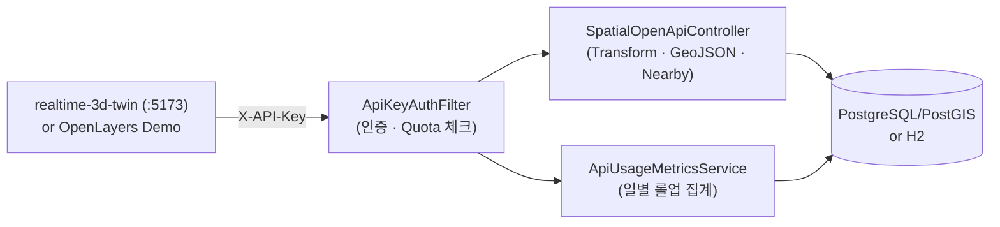

# spatial-openapi-sdk

[](https://github.com/duduri97/spatial-openapi-sdk/actions/workflows/ci.yml)

Java/Spring Boot 기반 **공간정보 OpenAPI 플랫폼 + 경량 JavaScript 지도 SDK** 레퍼런스 구현입니다.  
API 키 신청·승인·회수 워크플로우, 일일 호출량(Quota) 제어, 좌표계 변환(`EPSG:4326` ↔ `EPSG:3857` ↔ `EPSG:5179`), GeoJSON/반경 공간 검색, 그리고 **일별 롤업(Rollup) 기반 경량 로그 집계** 패턴을 공개·합성 데이터로 재현했습니다.

## 3-Repo 생태계 내 역할

본 레포지토리는 단독으로도 완전하게 실행되며, 로컬에서 [realtime-3d-twin](https://github.com/duduri97/realtime-3d-twin) · [sql-tuning-lab](https://github.com/duduri97/sql-tuning-lab)과 함께 실행할 경우 **3D 디지털 트윈에서 선택한 설비 좌표를 `EPSG:5179(UTM-K)`로 실시간 변환하고 OpenAPI 일별 롤업 메트릭을 제공**합니다.



## 핵심 설계 포인트

1. **API 키 수명주기 & 일일 Quota 제어**: `PENDING → APPROVED → REVOKED` 상태 전이로 승인 전/회수 후 호출을 필터 단계에서 차단(`401` / `403` / `429`).
2. **운영 로그 행 폭증 방지 (Rollup 집계)**: `(apiKey, endpoint, usageDate)` 단위로 호출 수·에러 수·누적 지연시간을 집계해 저장 행 수를 절감합니다.
3. **순수 Java 좌표 변환 엔진 (`EPSG:4326` / `3857` / `5179`)**: 외부 네이티브 의존성 없이 WGS84, Web Mercator, Korea 2000 UTM-K(`EPSG:5179`, GRS80) 간 정·역변환을 제공합니다.
4. **2단계 반경 검색**: Bounding-Box 인덱스 범위 필터 후 Haversine 정밀 거리를 계산·정렬합니다.

## 빠른 실행

```bash
# 테스트 + JaCoCo 커버리지 리포트
./mvnw test jacoco:report

# 로컬 실행 (:8080, OpenLayers 데모 및 3D 트윈 연동 대기)
./mvnw spring-boot:run
```

## 주요 API

| Method | Path | 설명 |
|---|---|---|
| `GET` | `/api/v1/health` | 서비스 상태 및 지원 CRS 확인 (`realtime-3d-twin` 자동 감지용) |
| `POST` | `/api/v1/keys/apply` | API 키 신청 (`PENDING`) |
| `POST` | `/api/v1/keys/{id}/approve` | API 키 승인 (`APPROVED`) |
| `POST` | `/api/v1/keys/{id}/revoke` | API 키 회수 (`REVOKED`) |
| `GET` | `/api/v1/metrics/summary` | 롤업 집계 및 로그 행 절감률 조회 |
| `GET` | `/openapi/v1/transform` | 좌표계 변환 (`4326` / `3857` / `5179`) |
| `GET` | `/openapi/v1/features/geojson` | 레이어/BBox 기준 RFC 7946 GeoJSON 조회 |
| `GET` | `/openapi/v1/features/nearby` | 중심 좌표 기준 반경(m) 내 공간 피처 검색 |
