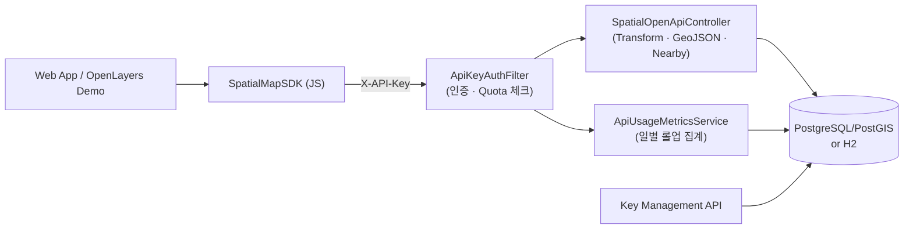

# spatial-openapi-sdk

Java/Spring Boot 기반 **공간정보 OpenAPI 플랫폼 + 경량 JavaScript 지도 SDK** 레퍼런스 구현입니다.  
API 키 신청·승인·회수 워크플로우, 일일 호출량(Quota) 제어, 좌표계 변환(`EPSG:4326` ↔ `EPSG:3857` ↔ `EPSG:5179`), GeoJSON/반경 공간 검색, 그리고 **일별 롤업(Rollup) 기반 경량 로그 집계** 패턴을 공개·합성 데이터로 재현했습니다.

## 아키텍처



## 핵심 설계 포인트

1. **API 키 수명주기 & 일일 Quota 제어**
   - `PENDING → APPROVED → REVOKED` 상태 전이로 승인 전/회수 후 호출을 필터 단계에서 차단(`401` / `403` / `429`).
2. **운영 로그 행 폭증 방지 (Rollup 집계)**
   - 요청마다 상세 로그 행을 쌓는 대신 `(apiKey, endpoint, usageDate)` 단위로 호출 수·에러 수·누적 지연시간을 집계해 저장 행 수를 대폭 절감합니다. (`/api/v1/metrics/summary`에서 절감률 확인 가능)
3. **순수 Java 좌표 변환 엔진 (`EPSG:4326` / `3857` / `5179`)**
   - 네이티브 GDAL/PROJ 의존성 없이 WGS84, Web Mercator, Korea 2000 UTM-K(`EPSG:5179`, GRS80 타원체) 간 정·역변환을 제공합니다.
4. **2단계 반경 검색 (Bounding-Box Pre-filter + Haversine)**
   - 위경도 인덱스 범위 필터로 후보군을 먼저 좁힌 뒤 정확한 Haversine 거리를 계산하고 정렬합니다.

## 빠른 실행

```bash
# 1) 테스트 + JaCoCo 커버리지 리포트
./mvnw test jacoco:report

# 2) 로컬 실행 (기본 H2 인메모리 DB + 샘플 공간데이터 자동 시딩)
./mvnw spring-boot:run
```

실행 후 브라우저에서 `http://localhost:8080`에 접속하면 **OpenLayers 지도 + SDK 데모 페이지**를 바로 체험할 수 있습니다.

### PostgreSQL / PostGIS 프로필로 실행

```bash
docker compose up -d
./mvnw spring-boot:run -Dspring-boot.run.profiles=postgres
```

## 주요 API

| Method | Path | 설명 |
|---|---|---|
| `POST` | `/api/v1/keys/apply` | API 키 신청 (`PENDING`) |
| `POST` | `/api/v1/keys/{id}/approve` | API 키 승인 (`APPROVED`) |
| `POST` | `/api/v1/keys/{id}/revoke` | API 키 회수 (`REVOKED`) |
| `GET` | `/api/v1/metrics/summary` | 롤업 집계 및 로그 행 절감률 조회 |
| `GET` | `/openapi/v1/transform` | 좌표계 변환 (`4326` / `3857` / `5179`) |
| `GET` | `/openapi/v1/features/geojson` | 레이어/BBox 기준 RFC 7946 GeoJSON 조회 |
| `GET` | `/openapi/v1/features/nearby` | 중심 좌표 기준 반경(m) 내 공간 피처 검색 |

## JavaScript SDK 사용 예

```js
const sdk = new SpatialMapSDK({ apiKey: 'demo-spatial-key-2026' });

const utmk = await sdk.transform({ x: 126.9780, y: 37.5665, from: 'EPSG:4326', to: 'EPSG:5179' });
const geojson = await sdk.getFeaturesGeoJson({ layer: 'LANDMARK' });
const nearby = await sdk.findNearby({ lon: 126.9780, lat: 37.5665, radiusMeters: 3000 });
```
